# ThRead - 반응형 웹 페이지 구성 (관통 프로젝트 03)

> AI 기반 도서 분석과 창작 지원 통합 솔루션 서비스 **ThRead**의 화면을 HTML, CSS, Bootstrap 5.3으로 구성한 프로젝트입니다.

## 저장소와 배포 주소

| 구분 | 주소 |
|---|---|
| 배포 사이트 (GitHub Pages) | https://jaeyunan.github.io/03-pjt/ |
| GitHub 저장소 | https://github.com/JaeYunAn/03-pjt |

배포 사이트는 `index.html`에서 메인 페이지(`06-main.html`)로 바로 이동합니다.

## 실행 방법

1. 배포 사이트(https://jaeyunan.github.io/03-pjt/)에서 바로 확인하거나, 이 저장소를 내려받습니다.
2. 내려받은 경우 `06-main.html`(또는 `index.html`)을 크롬으로 엽니다. (VS Code Live Server 사용 시 "Open with Live Server")
3. Bootstrap, 아이콘, 웹폰트를 CDN에서 불러오므로 인터넷 연결이 필요합니다.
4. 모바일 화면은 개발자 도구(F12) → `Ctrl + Shift + M` → 너비 412px로 확인합니다.

## 파일 구성

| 파일 | 내용 |
|---|---|
| `index.html` | GitHub Pages 첫 화면. 메인 페이지(`06-main.html`)로 이동 |
| `01-navbar.html` ~ `05-popular_thread.html` | 요구사항별 스켈레톤 구현 (F301 ~ F306, F310) |
| `06-main.html` | 01 ~ 05를 결합한 메인 페이지 + 도서 상세 화면 (F307 ~ F311) |
| `common.css` | 공통 디자인 시스템 (폰트, 색, 버튼, Navbar, 책 표지, 페이지네이션 등) |
| `06-main.css` | 메인 페이지 섹션 스타일 |
| `06-detail.css` | 도서 상세 화면 스타일 |
| `books.js` | 베스트셀러 12권 데이터 |
| `06-main.js` | 베스트셀러 Carousel, 상세 화면 전환, 담기, 안내 토스트 |
| `assets/` | 이미지와 폰트 (제공 자료) |
| `screenshots/` | 실행 화면 캡처 |
| `DESIGN_NOTES.md` | 디자인 의도와 결정 기록 |

## 구현 내용

### 필수 기능

| 번호 | 요구사항 | 구현 파일 | 구현 내용 |
|---|---|---|---|
| F301 | Navbar | `01-navbar.html` | 로고 Th(흰색) / Read(#fe4a51), GmarketSansTTFMedium, 메뉴 SBAggro_L 흰색 → hover #fe4a51, 투명 배경, 576px 미만 토글(`navbar-expand-sm`), absolute + z-index |
| F302 | Hero | `01-navbar.html` | 576px 미만에서 "AI 기반 도서 분석 및" 뒤 줄바꿈(` `), ThRead 색상과 폰트 |
| F303 | 베스트셀러 | `02-bestseller.html` | Carousel, 12권을 4권씩 3장 자동 순환, 왼쪽 제목 / 오른쪽 Carousel, 이미지 중앙 정렬, 150 x 220px 고정, Next 버튼만 |
| F304 | AI 추천 | `03-ai_recommendation.html` | 폭 80% 중앙 정렬, Grid 7:5, 수직 중앙 정렬, "활동 데이터 기반" 강조(#fe4a51, SBAggroOTF_L, 1.3rem) |
| F305 | 장르별 도서 목록 | `04-genre_list.html` | 폭 80%, Flexbox 4열, 이미지 부모 크기 채움 + 좌측 하단 장르명 오버레이, 고정 크기, 576px 미만 폭 100% 1열 |
| F306 | 인기 쓰레드 | `05-popular_thread.html` | Card(이미지 높이 고정, 제목과 본문, 하단에 저자와 도서명 #fe4a51 고정), 3열 / 1열, Pagination(높은 명시도, 테두리 제거, 활성 #fe4a51) |
| F307 | 메인 페이지 결합 | `06-main.html` | 01 ~ 05를 순서대로 결합, 공통 디자인 시스템(common.css)으로 폰트, 색, 간격 통일 |
| F308 | 로그아웃 확인창 | `06-main.html` | Modal, 오른쪽 위 닫기(X), 중앙 정렬 메시지, 취소 / 로그아웃 버튼, 바깥 클릭 시 닫힘. 모바일에서는 아래에서 올라오는 바텀 시트 |

### 심화 기능

| 번호 | 요구사항 | 구현 내용 |
|---|---|---|
| F309 | 베스트셀러 오버랩 | 베스트셀러 카드를 Hero 위에 반쯤 걸치게 배치하고 AI 추천 위치 조정 |
| F310 | 장르 동적 레이아웃 | 장르 목록 오른쪽 위 "모자이크" 버튼을 누르면 CSS Grid(`grid-template-columns`, `grid-auto-rows`, `gap`, `grid-template-areas` + `grid-area`)로 크기가 다른 배치. 기본 보기는 F305 Flexbox |
| F311 | 도서 상세 | 베스트셀러 12권 모두 상세 화면 제공. 100vh 표지 배경 Hero, 왼쪽 검정 → 오른쪽 투명 오버레이, archive 아이콘 "담기" 버튼, 소개글, 작가 소개, nav-tabs 2개(대여 가능 도서관: Google Map iframe / 쓰레드: 제목, 작성자, 좋아요 + 페이지네이션 + 쓰레드 작성) |

#### F311을 한 페이지 안의 화면으로 구현한 이유

채식주의자뿐 아니라 베스트셀러 12권 모두에 상세 화면을 만들기 위해, 책마다 HTML 파일을 따로 두는 대신 하나의 화면 틀에 `books.js` 데이터를 채우는 방식을 택했습니다.

- 책을 누르면 주소가 `06-main.html#book-2`처럼 바뀌고 상세 화면이 열립니다. 새로고침이나 링크 공유에도 같은 책이 열립니다.
- 브라우저 뒤로 가기와 "베스트셀러로 돌아가기" 모두 메인에서 보던 위치로 돌아옵니다.
- 메인과 같은 Navbar를 유지합니다.
- `assets/book_detail/book_cover.jpg`가 제공되지 않아 각 책의 베스트셀러 표지 이미지를 흐려서 배경으로 사용했습니다.

### 추가 구현

- 넓은 화면(27인치 등)에서는 베스트셀러가 4권씩인 것은 그대로 두고, 표지 옆에 저자, 순위 변동, 평점을 펼쳐 빈 공간을 채움
- Hero 오른쪽 "이번 주의 책" (데스크탑)
- 베스트셀러 순위 변동(▲ ▼ NEW), "1 / 3" 위치 표시, 자동 넘김 멈춤 버튼
- 아직 만들지 않은 기능은 "아직 준비 중인 기능이에요" 안내
- 인기 쓰레드의 도서명을 누르면 해당 책 상세 화면으로 이동
- 상세 화면 도서관을 누르면 지도가 해당 도서관으로 이동
- 모바일 하단 탭 바, 바텀 시트 로그아웃 창

## 실행 화면

### F301, F302 Navbar와 Hero

| 데스크탑 | 모바일 | 모바일 메뉴 |
|---|---|---|
|  |  |  |

### F303 베스트셀러

| 데스크탑 | 모바일 |
|---|---|
| 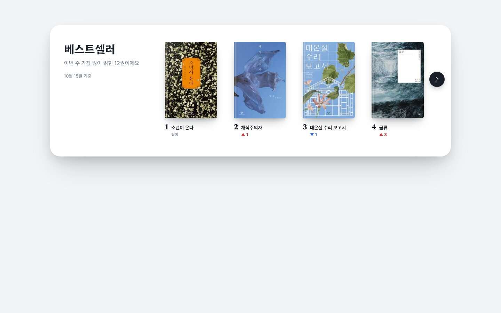 | 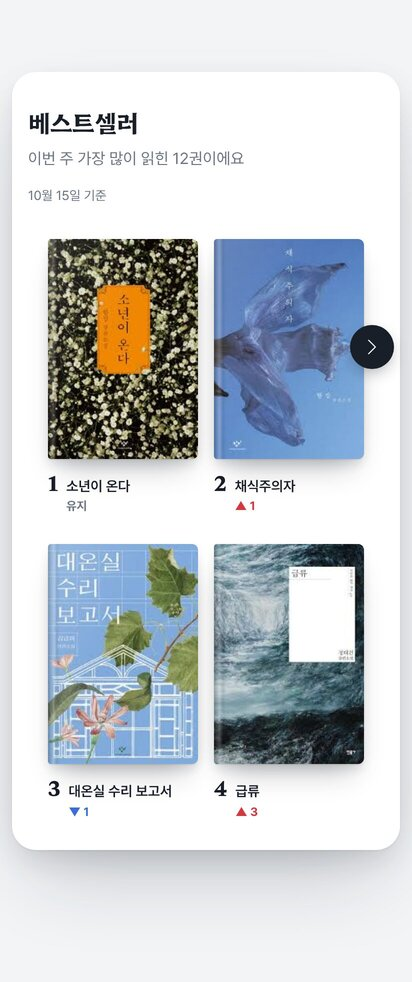 |

### F304 AI 추천

| 데스크탑 | 모바일 |
|---|---|
| 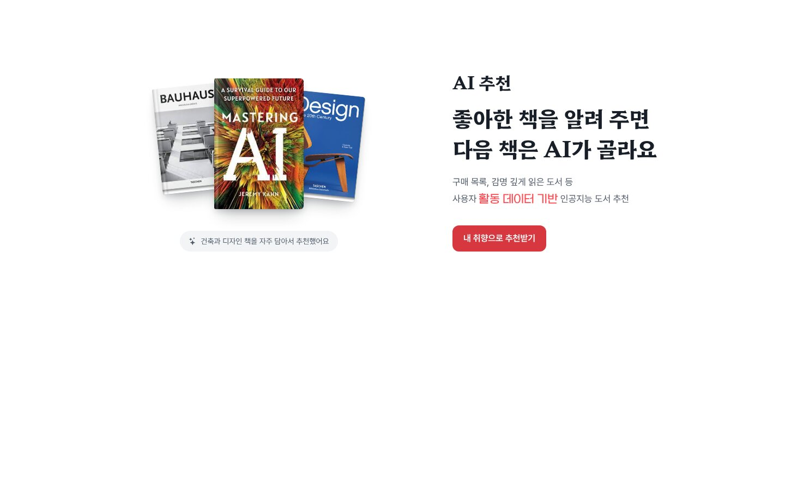 | 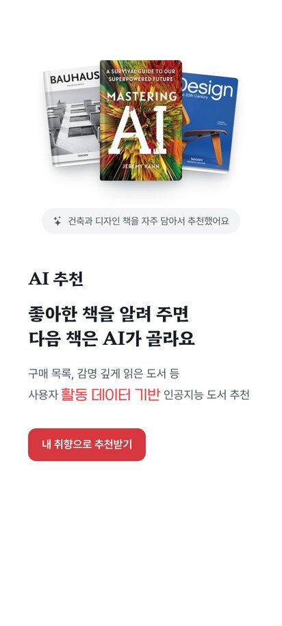 |

### F305 장르별 도서 목록 / F310 모자이크 보기

| F305 데스크탑 | F305 모바일 | F310 데스크탑 | F310 모바일 |
|---|---|---|---|
| 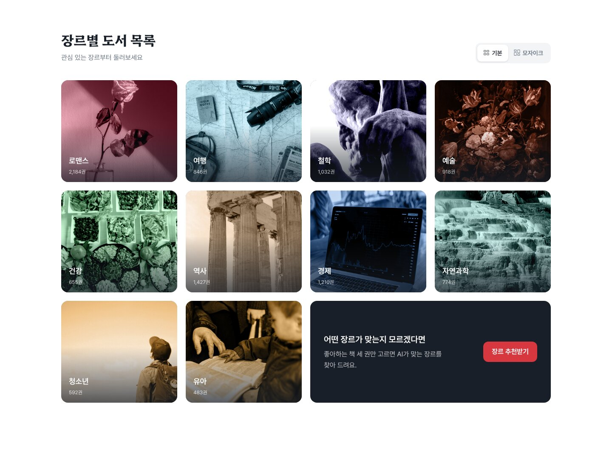 |  | 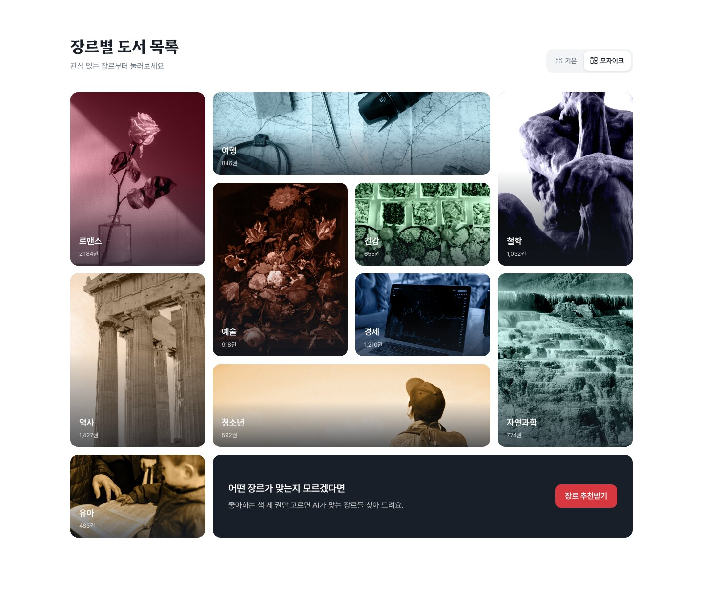 | 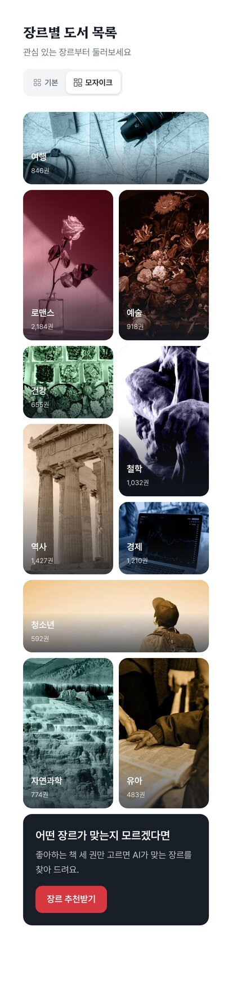 |

### F306 인기 쓰레드

| 데스크탑 | 모바일 |
|---|---|
| 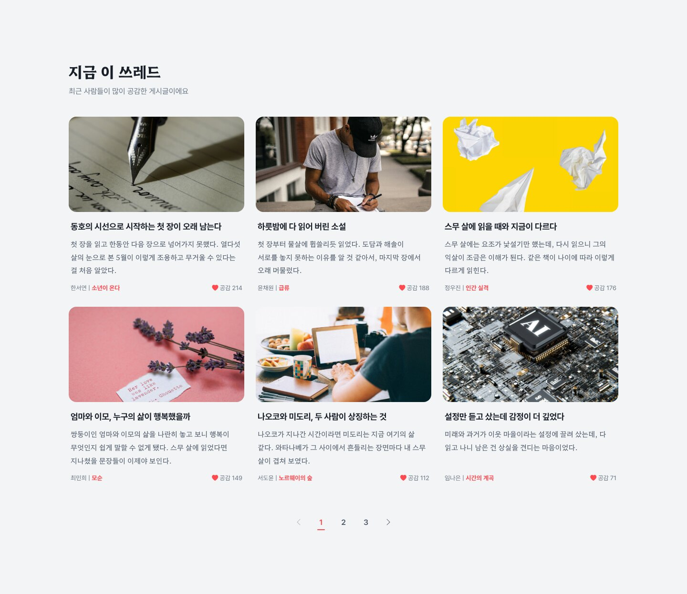 |  |

### F307 메인 페이지 / F309 베스트셀러 오버랩

| 첫 화면 데스크탑 | 첫 화면 모바일 | 전체 데스크탑 | 전체 모바일 |
|---|---|---|---|
| 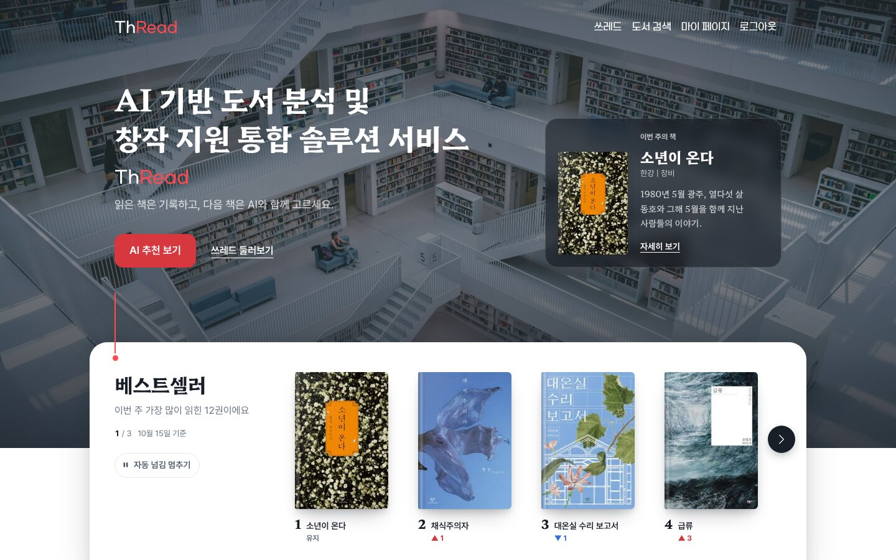 |  |  |  |

### F308 로그아웃 확인창

| 데스크탑 | 모바일 |
|---|---|
| 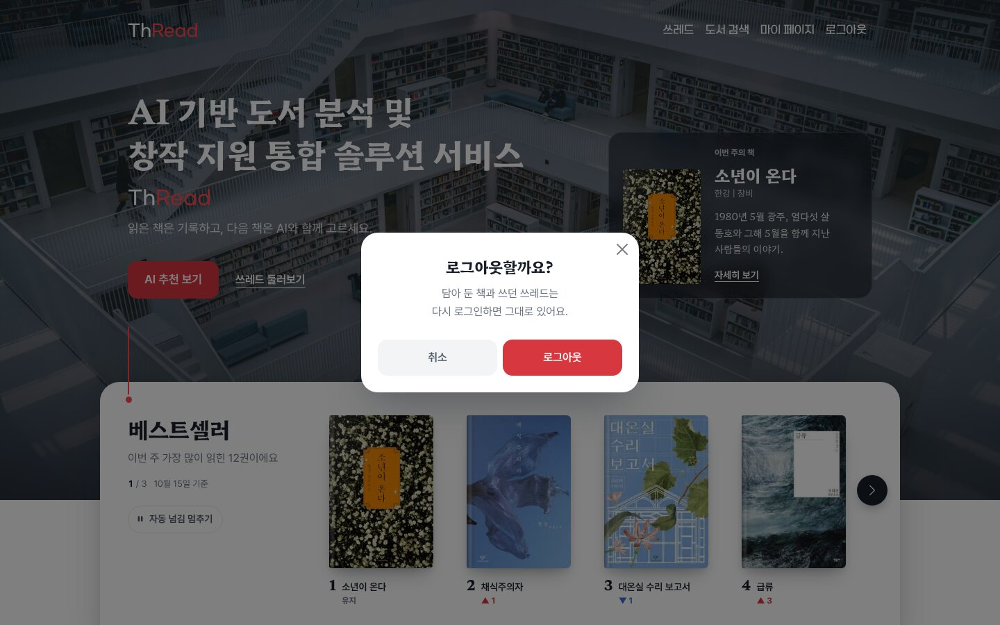 |  |

### F311 도서 상세

| 데스크탑 | 데스크탑 전체 | 모바일 |
|---|---|---|
| 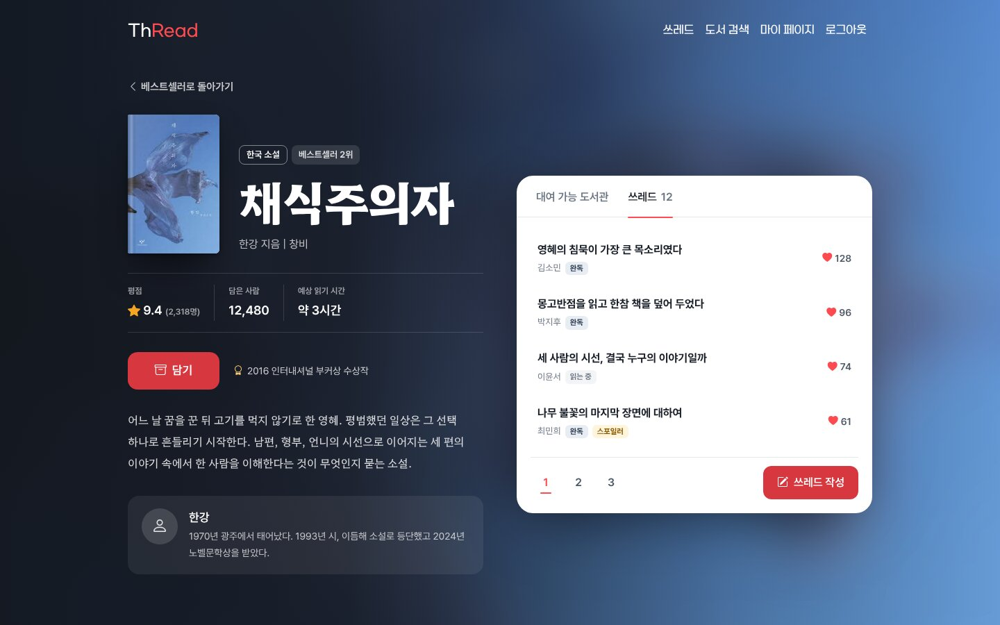 | 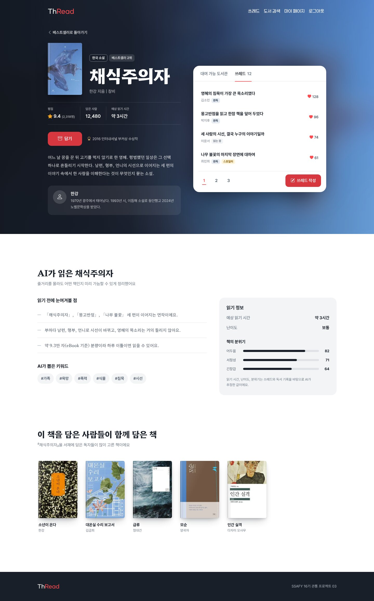 | 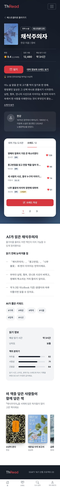 |

| 대여 가능 도서관 탭 데스크탑 |
|---|
| 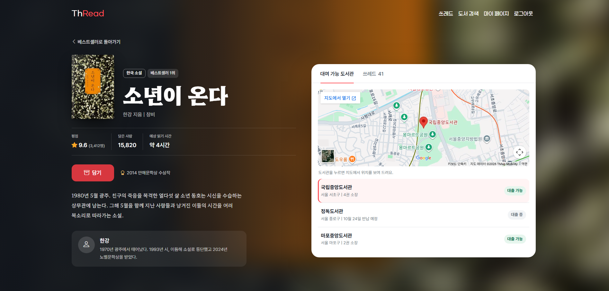 |

## 디자인 방향

자세한 내용은 [`DESIGN_NOTES.md`](DESIGN_NOTES.md)에 정리했습니다.

- **콘셉트 "붉은 실":** ThRead = Thread(실) + Read. 붉은 실을 "지금 여기"를 가리키는 표시로 사용 (Hero에서 베스트셀러로 내려오는 선, 현재 탭, 현재 페이지, 읽기 진행 바)
- **서체:** 제목과 읽는 글은 Hahmlet(함렛), UI는 Pretendard, 명세 지정 위치는 Gmarket Sans / 어그로체 (모두 OFL 등 사용 가능한 라이선스)
- **색:** 브랜드 색 #fe4a51은 명세 지정 위치, 주 버튼, 붉은 실에만 아껴 사용
- **참고 서비스:** 넷플릭스(첫 화면 대표 작품, 순위), 밀리의서재(표지 색 배경, 읽기 정보), 네이버 시리즈(평점, 키워드, 순위 변동), 토스(사람 말투, 엄지 존), Apple(섹션당 메시지 하나), Airbnb(실물 같은 책 표지)
- **수업의 UX 기준 3가지:** 잘 읽히는가(Web Font) / 폰에서도 편한가(Media Query) / 믿고 쓸 수 있는가(AI 결과 검수)

## GitHub Pages 배포

수업의 GitHub Pages 배포 과정을 따라 배포했습니다.

1. GitHub 저장소를 Public으로 생성하고 파일을 push
2. 첫 화면 파일 이름은 반드시 `index.html`이어야 하므로, `06-main.html`로 이동하는 `index.html`을 저장소 맨 위에 추가
3. Settings → Pages → Branch(main 또는 master) 선택 → Save
4. 1~2분 뒤 `https://아이디.github.io/저장소이름`으로 접속해 확인

배포 후에는 수업의 UX 기준 3가지(잘 읽히는가 / 폰에서도 편한가 / 믿고 쓸 수 있는가)로 실제 휴대폰에서 다시 점검했습니다. [ ]

## 생성형 AI 활용

### 사용한 도구

- Claude

### 활용한 부분

- 명세서와 수업 자료를 바탕으로 디자인 방향과 차별화 아이디어 정리
- 참고 서비스(넷플릭스, 밀리의서재, 네이버 시리즈 등) 장단점 분석
- 메인 페이지, 도서 상세 화면, 01 ~ 05 파일의 코드 초안 작성
- 베스트셀러 12권의 저자, 출판사 등 도서 정보 조사 보조
- README와 디자인 노트의 틀 작성

### 직접 검토하고 수정한 부분

- [ ] 예: 명세 요구사항과 하나씩 대조해 어긋난 부분 수정 (베스트셀러 4권 고정 등)
- [ ] 예: 폰트와 색을 직접 비교해 보고 결정
- [ ] 예: 팀원이 맡은 부분을 실행해 보고 고친 점

### AI 결과 검수 (수업 108p 검수표 적용)

| 확인할 것 | 확인 방법 | 결과 |
|---|---|---|
| 버전 | `<link>`의 Bootstrap 주소 | 5.3.3으로 고정 |
| 반응형 | 개발자 도구에서 412px 입력 | 576px 미만 토글 메뉴, 1열 배치, 바텀 시트 확인 |
| 폰트 | 개발자 도구 Computed → Rendered Fonts | 스켈레톤의 `format("ttf")` 오류를 `"truetype"`으로 수정 |
| 버튼 동작 | 직접 클릭 | 아직 없는 기능은 "준비 중" 안내, 탭 / Modal / Carousel 동작 확인 |
| [ ] | [ ] | [ ] |

## 데이터 안내

- 도서의 제목, 저자, 출판사, 소개, 작가 소개, 수상 내역은 실제 정보를 바탕으로 요약해 작성했습니다.
- 평점, 담은 사람 수, 도서관 대출 상태, 쓰레드, 분위기 점수 등은 화면 구성을 위한 예시 데이터입니다.

## 회고

### [팀원 1 이름]

- **학습한 내용:** [ ]
- **어려웠던 부분:** [ ]
- **새로 배운 것:** [ ]
- **느낀 점:** [ ]

### [팀원 2 이름]

- **학습한 내용:** [ ]
- **어려웠던 부분:** [ ]
- **새로 배운 것:** [ ]
- **느낀 점:** [ ]

### [팀원 3 이름]

- **학습한 내용:** [ ]
- **어려웠던 부분:** [ ]
- **새로 배운 것:** [ ]
- **느낀 점:** [ ]

## 참고 자료

- [Bootstrap 5.3 공식 문서](https://getbootstrap.com/)
- [Pretendard (OFL)](https://github.com/orioncactus/pretendard)
- [Hahmlet (Google Fonts, OFL)](https://fonts.google.com/specimen/Hahmlet)
- 도서 정보: 교보문고, 리디, 예스24, 시사저널 등 공개 도서 정보
